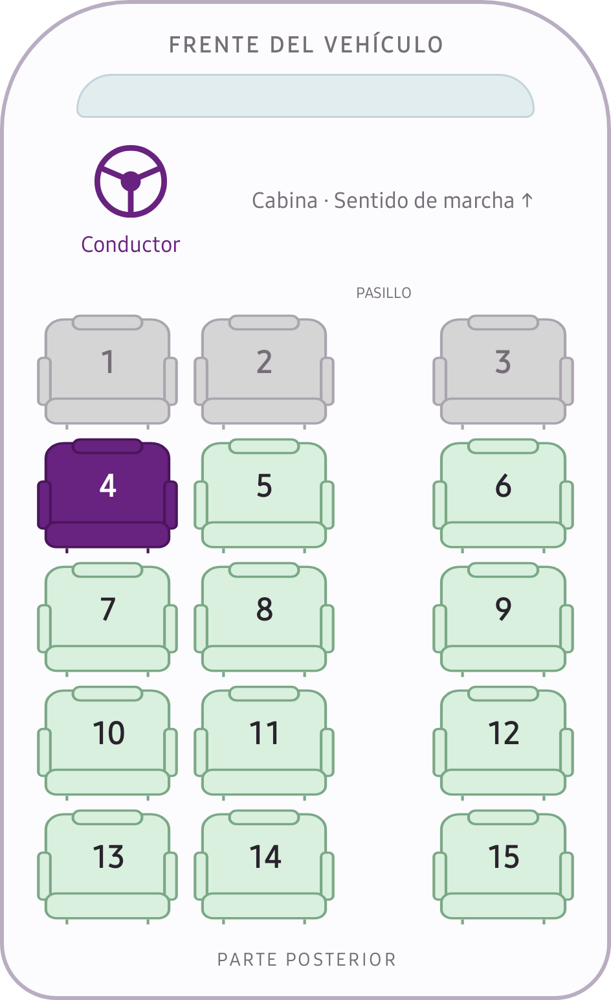

# Diseno de asientos con silueta de combi
+
+Se adapto la referencia visual enviada por el usuario: carroceria con esquinas curvas, parabrisas, conductor al frente, pasillo y asientos con respaldo, apoyabrazos y cojin. Se mantienen Kotlin y XML.
+
+La referencia tiene veinte plazas, pero el inventario actual de prueba tiene quince. Este cambio conserva las quince, sus numeros, filas y estados. Para inventarios de tres columnas se separan visualmente las columnas 1 y 2 de la columna 3 mediante un pasillo, formando 2+1. El conductor y la cabina son decorativos y no se pueden reservar. La forma visual no certifica una distribucion fisica oficial de la flota.
+
+Verde identifica libre, morado elegido y gris no disponible. El numero sigue siendo texto de un Button nativo, con descripcion accesible y el mismo controlador de seleccion. Los asientos no disponibles o bloqueados no admiten pulsaciones. No se crean asientos adicionales ni se modifican reservas, compras o datos SQL.
+
+Archivos principales: comprar_boleto.xml define carroceria, cabina y contenedor; fondo_combi.xml, parabrisas_combi.xml y volante_combi.xml aportan los recursos nativos; AsientoCombiDrawable.kt dibuja cada asiento; CompraFragment.kt conecta esos botones con el inventario existente. Los bloques principales contienen comentarios generales.
+
+Validacion del 13 de noviembre de 2026: assembleDebug, assembleDebugAndroidTest y lintDebug aprobados. La prueba visual existente se adapto para contar solo Buttons y excluir los espacios del pasillo; en el Samsung obtuvo OK (1 test), comprobo quince plazas y habilitacion de Reservar tras elegir una libre. No creo reservas ni cargos. La imagen procede del render de la vista real de Android, no de un boceto generado.
+
+
+