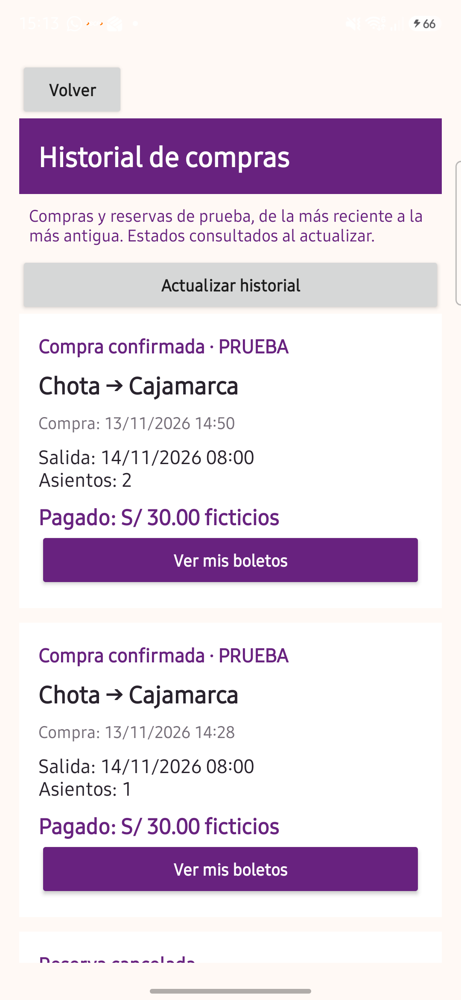

# Sprint 5: Historial de compras conectado

## Resultado y recorrido

Inicio -> Historial muestra las reservas y compras de la cuenta autenticada. Hay una fila por reserva, aunque incluya varios pasajeros; una compra de dos asientos de S/ 30 figura como una sola compra de S/ 60 ficticios.

1. Iniciar sesion y pulsar Historial.
2. Revisar estado, ruta, fecha de compra o reserva, salida, asientos e importe.
3. Una compra CONFIRMADA muestra Pagado y Ver mis boletos. Ese boton abre los boletos ya emitidos de la reserva; desde ellos tambien se puede abrir el detalle con QR.
4. Una reserva PENDIENTE, CANCELADA o EXPIRADA muestra Total reservado y Sin pago registrado. No ofrece boletos ni representa ese importe como dinero cobrado.
5. Actualizar historial reinicia la consulta desde la primera pagina. Cargar mas registros agrega la siguiente pagina cuando existe.
6. Volver desde los boletos regresa al historial conservando las paginas y el desplazamiento. Volver desde Historial regresa a Inicio.

Los estados corresponden al momento de la consulta; Actualizar historial vuelve a leerlos del servidor. El historial no cancela, paga ni reanuda reservas. Tampoco genera boletos nuevos. No se implementa aqui una accion de reembolso.

## Estados e importes

| Estado | Texto de pantalla | Importe cobrado | Accion |
| --- | --- | --- | --- |
| CONFIRMADA con pago registrado | Compra confirmada - PRUEBA | Total del pago ficticio | Ver mis boletos |
| PENDIENTE y vigente | Reserva pendiente de pago | S/ 0.00 | Consulta informativa |
| CANCELADA | Reserva cancelada | S/ 0.00 | Consulta informativa |
| EXPIRADA o plazo vencido | Reserva vencida | S/ 0.00 | Consulta informativa |

La API conserva total_reserva e importe_pagado por separado. Android valida que una compra confirmada tenga pago, fecha de pago, total coincidente y un boleto por asiento. Si recibe datos inconsistentes no fabrica una compra ni un importe: muestra error de datos. Las pruebas de saldo ficticio no equivalen a operaciones de dinero real.

## API protegida y paginacion

GET /api/v1/historial acepta despues (UUID de una reserva propia) y limite (1 a 50, predeterminado 20). Responde datos (arreglo de registros) y siguiente (UUID o null). Android solicita paginas de 20.

Cada registro contiene identificador, salida, estado efectivo, fecha de creacion, ruta, salida del viaje, cantidad/asientos, total reservado, importe pagado, fecha de pago, indicador pagada y numero de boletos emitidos. No devuelve UID, DNI, nombres o celular de los pasajeros. Usa PEN y modo PRUEBA.

La autenticacion Firebase determina el propietario; la API no acepta UID del formulario ni en la consulta. Sin sesion devuelve 401, con parametros invalidos 400 y con cursor inexistente/ajeno 404. Cache-Control es no-store. El servidor rechaza parametros desconocidos o repetidos.

El orden es creado_en DESC, id DESC: se organiza por fecha de creacion de la reserva, no por fecha de salida del viaje ni por la ultima consulta. La tarjeta pagada muestra la fecha efectiva del pago. El cursor obtiene su fecha desde PostgreSQL para conservar microsegundos y desempata por UUID; una respuesta lee un registro adicional para saber si hay otra pagina.

Una reserva PENDIENTE cuyo plazo ya vencio se informa como EXPIRADA sin ejecutar limpieza ni UPDATE durante esta consulta. Los registros pagados usan la ruta y salida copiadas al emitir el boleto; los no pagados usan el catalogo actual, porque no existe boleto historico de ellos. Las copias de compras anteriores a la migracion 009 conservan la limitacion de datos recuperados descrita en la guia de emision.

## Archivos y comentarios para la exposicion

| Archivo | Funcion del bloque |
| --- | --- |
| backend/src/historial.js | Consulta parametrizada, pagina, estado efectivo y validacion de la ruta |
| backend/src/app.js | Registra el endpoint del historial |
| data/model/RegistroHistorial.kt | Diferencia total reservado de importe pagado |
| data/remote/ReservasApi.kt | Declara GET /api/v1/historial |
| data/repository/ReservasRepository.kt | Contrato de consulta del historial |
| data/repository/RetrofitReservasRepository.kt | Usa token por peticion y valida estados, importes, fechas, asientos y cursor |
| ui/compra/HistorialComprasViewModel.kt | Carga paginas, conserva registros ante fallo posterior y descarta datos si cambia la cuenta |
| ui/compra/HistorialComprasFragment.kt | Muestra tarjetas con RecyclerView y abre los boletos de una compra |
| ui/inicio/InicioFragment.kt | Conecta el boton Historial |
| res/layout/historial_compras.xml | Pantalla funcional que reemplaza el ejemplo estatico |
| res/layout/item_historial.xml | Estado, ruta, fechas, asientos, importe y accion de cada registro |

Las rutas Kotlin parten de app/src/main/java/com/app/transporte_chota_bus; los XML parten de app/src/main. Hay comentarios generales en los bloques principales. No se agregaron dependencias ni migraciones SQL. Los argumentos de navegacion solo transportan el identificador de reserva; los registros se mantienen en memoria del ViewModel, no en DataStore ni como datos personales dentro del Bundle.

## Pruebas realizadas — 2026-11-13

- 89 pruebas HTTP/unitarias de servidor aprobadas.
- 51 pruebas PostgreSQL/HTTP aprobadas en un esquema temporal aislado, eliminado al terminar. Cubren los cuatro estados, total pagado, agrupacion por reserva, copia del viaje, paginacion con fechas iguales y microsegundos, cursor ajeno y ausencia de modificaciones al consultar.
- 176 pruebas unitarias Android aprobadas; incluyen rechazo de importes/estados inconsistentes, asientos duplicados, reserva cancelada sin cobro, paginacion, reintento y cambio de cuenta.
- assembleDebug, assembleDebugAndroidTest y lintDebug aprobados. Se conserva la advertencia previa de AGP/compileSdk 37.1.
- Dos pruebas directas en Samsung aprobadas: recorrido Inicio -> Historial -> boletos -> regreso, con recreacion de actividad, y regresion de Mis boletos/QR.
- El servidor fue reiniciado por el usuario y se comprobo 401 al consultar historial sin sesion.
- La app se actualizo con adb install -r conservando datos. Las pruebas del telefono solo consultaron compras existentes: no crearon reservas, pagos ni boletos, y verificaron que el saldo no cambiara.

Comandos de comprobacion desde Git Bash, dentro de backend:

```bash
npm test
npm run test:db
```

Desde la raiz Android:

```bash
./gradlew :app:testDebugUnitTest :app:assembleDebug :app:assembleDebugAndroidTest :app:lintDebug
```

La prueba HistorialComprasInstrumentedTest es optativa con historialServidor=true. Requiere telefono desbloqueado, sesion iniciada y alguna compra ya pagada; puede cargar paginas para encontrarla. Se ejecuta mediante am instrument y adb reverse, no connectedDebugAndroidTest en el telefono personal.

## Evidencia

La captura no contiene datos personales del pasajero. Muestra compras efectivas con sus importes pagados y el acceso a los boletos existentes.



Este incremento queda documentado aparte; los documentos maestros de Word no se modificaron. No se creo un commit ni se publico el avance automaticamente. El siguiente trabajo corresponde a la validacion integral contra los requerimientos y los trabajos de campo, la revision de pendientes y el registro del incremento en Git; este modulo por si solo no declara todo el proyecto terminado.
