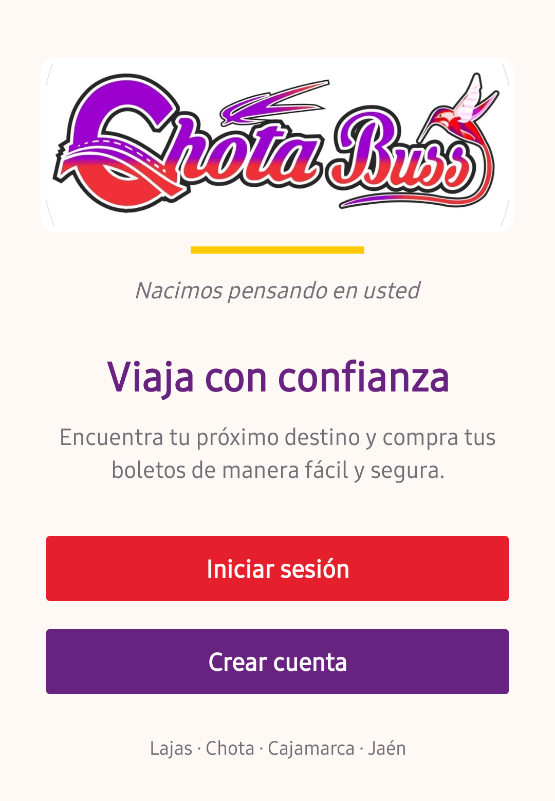
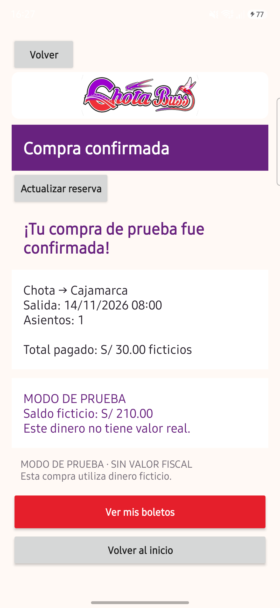

# Logo proporcionado por el usuario
+
+Se incorporo DISEÑO.jpeg como recurso drawable-nodpi/logo_chota_bus.jpg. El archivo conserva exactamente los bytes, colores y dibujo del original; solo cambia el nombre del recurso para cumplir la convencion de Android. SHA256: cbe05ffaef6cba6a9ae24f6fd9cd11701f6b059abb4a27d477144d8aa940423c.
+
+LogoChotaView, en ui/marca, presenta la franja central de la marca sin deformarla y omite visualmente el margen blanco excesivo del JPEG. El archivo no se recorta ni se vuelve a comprimir. El componente mantiene proporcion y centra la imagen en cabeceras compactas y bloques grandes, con fondo blanco redondeado y descripcion accesible. Si se sustituye por otro logo con distinta composicion, se debe revisar esa ventana de presentacion.
+
+Se usa en bienvenida, inicio de sesion, registro, recuperacion de contrasena, Inicio, perfil, resultados, compra de asientos, mapa del terminal, datos/resumen/confirmacion, Mis boletos, historial y tarjetas de boletos. El detalle con QR lleva el logo en cabecera y oculta la copia de la tarjeta reutilizada para no repetir la imagen en la misma pantalla. Los titulos y los IDs funcionales de los formularios se conservan.
+
+La bienvenida ahora usa el logo como imagen principal y conserva el lema, las instrucciones y los accesos. Se retiro la ilustracion provisional del emoji de bus. Las interfaces siguen siendo XML y el componente Kotlin incluye comentarios generales para explicar su funcion.
+
+Validacion del 13 de noviembre de 2026: assembleDebug, assembleDebugAndroidTest y lintDebug aprobados. Dos pruebas directas en el telefono finalizaron con OK (2 tests): confirmacion/boletos y Mis boletos/detalle QR, incluyendo recreacion de actividad y retorno. No se realizaron compras ni cargos nuevos y se conservo la sesion con adb install -r.
+
+La imagen de bienvenida se renderizo a partir del XML Android sin ejecutar su restauracion automatica de sesion, para poder revisar el diseno sin desconectar al usuario. La segunda imagen corresponde a una captura de la confirmacion real en el telefono y no incluye datos personales de pasajeros.
+
+
+
+
+