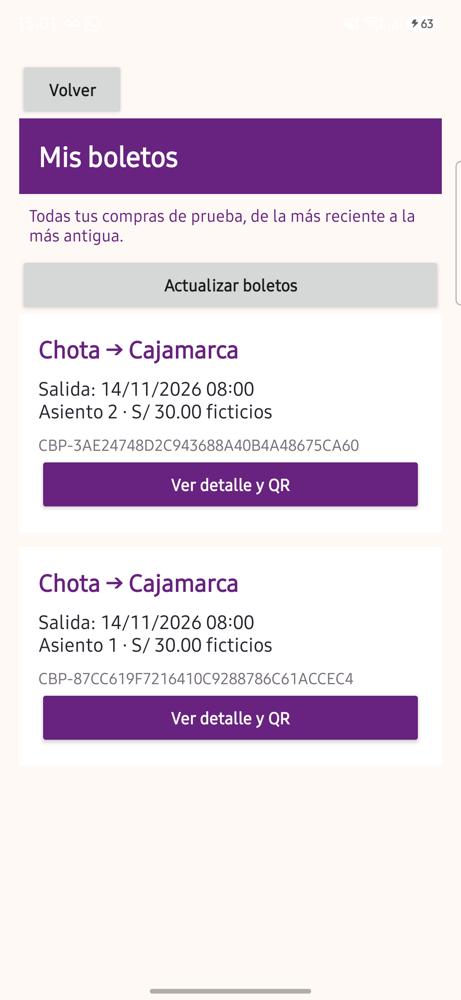

# Mis boletos desde Inicio y detalle con QR

Este incremento conecta la consulta general de boletos propios con Inicio y agrega el detalle con QR. Completa la visualizacion de los boletos emitidos en Sprint 4 e inicia el modulo Mis boletos previsto en Sprint 5. No declara completado el historial ni todo el Sprint 5.

## Recorrido para la exposicion

1. Iniciar sesion y pulsar Mis boletos en Inicio.
2. La pantalla consulta las compras de la cuenta y muestra los boletos emitidos, ordenados por emision de mas reciente a mas antigua. Incluye boletos de viajes pasados; no presenta solo viajes futuros.
3. Cada tarjeta muestra ruta, salida, asiento, importe ficticio y codigo. La lista no muestra nombre ni DNI.
4. Pulsar Ver detalle y QR. Se consulta nuevamente el boleto por su identificador y se muestran la copia del pasajero/viaje y el QR.
5. Volver regresa a la lista, conservando sus paginas y desplazamiento. Actualizar boletos inicia la consulta desde la primera pagina. Cargar mas boletos incorpora la siguiente pagina si existe.
6. Tambien se puede abrir Ver detalle y QR desde los boletos de una compra recien confirmada.

Una cuenta sin compras muestra un mensaje vacio. Un error permite reintentar; si falla una pagina posterior se conservan los boletos ya cargados. Una sesion rechazada ofrece iniciar sesion. El cambio de cuenta descarta los datos en memoria al verificar la sesion, y el repositorio comprueba la identidad antes y despues de cada solicitud.

## API y paginacion

GET /api/v1/boletos acepta despues (UUID de un boleto propio) y limite (1 a 50; predeterminado 20). Devuelve datos y siguiente (UUID o null). Android usa paginas de 20 y solo solicita otra al pulsar Cargar mas.

La consulta SQL filtra por el UID del token verificado. El cursor debe pertenecer al mismo usuario: uno inexistente o ajeno devuelve 404. Parametros desconocidos, repetidos o invalidos devuelven 400; sin sesion se devuelve 401. Se conserva Cache-Control: no-store.

El orden usa emitido_en DESC, id DESC. La fecha del cursor se consulta dentro de SQL, sin reconstruirla desde JavaScript, por lo que conserva los microsegundos y permite paginar sin saltos por redondeo. El UUID desempata fechas iguales. Cada respuesta lee un registro adicional para saber si existe otra pagina; no necesita contar todas las compras.

GET /api/v1/boletos/:id sigue entregando el detalle solo al propietario. No existe una consulta publica por QR ni se permite escoger el UID mediante parametros.

## Contenido del QR

El QR se genera localmente con com.google.zxing:core:3.5.4 y contiene unicamente:

```text
CHOTA_BUS:PRUEBA:v1:CBP-<32 caracteres hexadecimales>
```

No contiene nombre, DNI, celular, correo, token Firebase, importe ni enlace a un servicio externo. No requiere permisos de camara ni subir la imagen a internet. El codigo no actua como credencial de acceso ni prueba de autenticidad: es un identificador de demostracion, copiable como cualquier QR. Un futuro control de embarque necesitara una operacion autenticada de personal autorizado y validacion de estado/uso en servidor. Este incremento no marca boletos como usados ni autoriza embarque.

La imagen tiene margen blanco y pixeles cuadrados. Se genera en Dispatchers.Default para no ocupar la interfaz; la tarea se cancela al destruir la vista. Se regenera al recrear la pantalla a partir del codigo del boleto consultado.

Referencias oficiales consultadas: [ZXing](https://github.com/zxing/zxing), [QRCodeWriter](https://zxing.github.io/zxing/apidocs/com/google/zxing/qrcode/QRCodeWriter.html), [version 3.5.4](https://github.com/zxing/zxing/releases/tag/zxing-3.5.4).

## Archivos y bloques para explicar

| Archivo | Responsabilidad |
| --- | --- |
| backend/src/boletos-repository.js | Lista paginada y filtrada por propietario |
| backend/src/boletos-routes.js | Autenticacion y validacion de parametros |
| data/model/BoletoPrueba.kt | Modelo del boleto y PaginaBoletos |
| data/remote/ReservasApi.kt | Consulta general y detalle por identificador |
| data/repository/RetrofitReservasRepository.kt | Token por solicitud, validacion de paginas, cursor y detalle |
| ui/compra/MisBoletosViewModel.kt | Estado de lista, carga de paginas y errores |
| ui/compra/MisBoletosFragment.kt | RecyclerView, tarjetas y navegacion |
| ui/compra/DetalleBoletoViewModel.kt | Consulta privada del boleto seleccionado |
| ui/compra/DetalleBoletoFragment.kt | Detalle XML y bitmap del QR en segundo plano |
| domain/model/QrBoletoPrueba.kt | Construccion del contenido y matriz QR |
| res/layout/mis_boletos.xml | Pantalla funcional que reemplaza el ejemplo estatico |
| res/layout/item_mi_boleto.xml | Tarjeta de la lista general |
| res/layout/detalle_boleto.xml | Detalle y QR, reutilizando los campos del boleto emitido |

Las rutas Kotlin parten de app/src/main/java/com/app/transporte_chota_bus; las de recursos, de app/src/main. Se agregaron comentarios generales a los bloques principales. No se cambiaron documentos maestros, no se modificaron saldos ni se aplicaron migraciones SQL nuevas. El servidor fue reiniciado por el usuario para cargar la ruta de lista general.

## Pruebas realizadas — 2026-11-13

- 81 pruebas HTTP/unitarias del servidor aprobadas.
- 47 pruebas PostgreSQL/HTTP aprobadas en un esquema temporal aislado; incluyen paginacion con fechas iguales y microsegundos, aislamiento de cuentas y cursor ajeno.
- 166 pruebas unitarias Android aprobadas. Cubren paginas, reintentos, duplicados, cambio de cuenta, detalle incorrecto, modo de prueba y decodificacion real del QR.
- assembleDebug, assembleDebugAndroidTest y lintDebug completados sin errores. Se conserva la advertencia previa de AGP/compileSdk.
- Dos pruebas directas en Samsung aprobadas: Mis boletos desde Inicio con lectura del QR, recreacion y regreso; y regresion del recorrido confirmacion/boletos.
- Las pruebas del telefono solo consultaron compras existentes y comprobaron que saldo y boletos permanecieran iguales. No crearon cargos nuevos. Se instalo con adb install -r para conservar la sesion; no se uso connectedDebugAndroidTest.

Las evidencias muestran la lista sin nombres/DNI y la imagen aislada del QR. No se exporta una captura del detalle personal del pasajero.




## Comandos de comprobacion

En Git Bash, desde backend:

```bash
npm test
npm run test:db
```

Desde la raiz Android:

```bash
./gradlew :app:testDebugUnitTest :app:assembleDebug :app:assembleDebugAndroidTest :app:lintDebug
```

La prueba MisBoletosQrInstrumentedTest es optativa: misBoletosServidor=true, telefono desbloqueado, sesion iniciada y al menos una compra ya pagada. Usa adb reverse tcp:3000 tcp:3000 y am instrument; no imprime tokens ni datos personales.

## Siguiente incremento

Conectar Historial desde Inicio y consultar compras con fecha, importe y estado. Las reservas canceladas o vencidas deberan identificarse como tales, sin contarlas como compras cobradas. El detalle de una compra confirmada reutilizara los boletos existentes; consultar historial no debera crear pagos ni emitir documentos nuevos.

Actualizacion: ya se conecto el [Historial de compras y reservas](historial-compras.md), con acceso a los boletos de las compras confirmadas.
