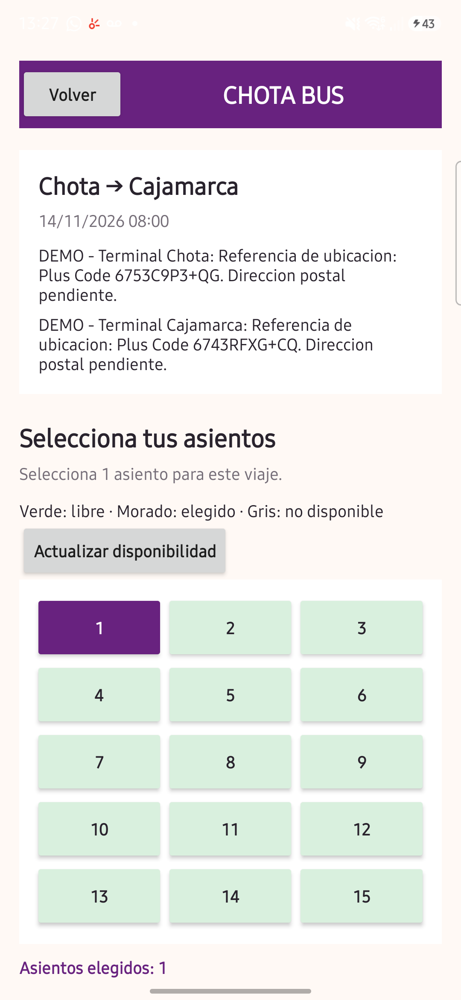

# Sprint 4 — seleccion y reserva de asientos desde Android XML

## Flujo implementado

Inicio -> Buscar viajes -> Seleccionar salida -> Seleccion de asientos -> Reservar -> Cancelar o esperar vencimiento. Ver terminales continua disponible como accion separada. La cantidad de asientos debe coincidir con los pasajeros indicados en la busqueda. La reserva es temporal: este incremento no registra pasajeros, no procesa pagos ni emite boletos.

Se reemplazan los asientos y precios fijos del boceto comprar_boleto.xml por el inventario y el precio de la API. La pantalla conserva los colores, el marco y las interfaces XML. Los botones se construyen desde fila y columna; las distribuciones actuales de 15 asientos y tres columnas son DEMO, no planos oficiales de la empresa.

## Bloques para explicar en la exposicion

- FirebaseProveedorTokenSesion obtiene el ID token de la cuenta actual en memoria mediante getIdToken. El token no se guarda en SavedStateHandle, DataStore, archivos ni registros.
- ReservasApi define las cuatro peticiones protegidas. Solo envia salidaId, asientos y solicitudId para reservar. No recibe ni envia precio o UID en ese formulario.
- RetrofitReservasRepository agrega Authorization, renueva una sola vez ante 401 y mantiene la solicitud original. Comprueba que la cuenta no haya cambiado antes o despues de la peticion. Valida fechas, distribucion, cantidad e importes recibidos.
- CompraViewModel controla seleccion, consultas, reserva, reintento, cancelacion y vencimiento. Conserva ids, UUID del intento y seleccion en SavedStateHandle, asociados al UID propietario para evitar recuperar datos de otra cuenta. Los ids se vuelven a consultar al servidor al recrear el proceso.
- CompraFragment observa el estado con el ciclo de vida de la vista, presenta la distribucion, los totales y las acciones. No repite la reserva al girar. El contador se actualiza mientras la vista esta activa y se calcula con hora_servidor y reloj monotono; es una referencia visual, la decision final de vencimiento siempre la toma PostgreSQL.

Todos los bloques principales incluyen comentarios generales. Se usa la arquitectura MVVM y Repository existente y la conexion local debug con adb reverse. La version release sigue pendiente de configurar una API HTTPS.

## Respuestas inciertas y salida de la pantalla

Antes de crear una reserva se guarda un UUID y sus asientos. Si se pierde la respuesta, la seleccion queda bloqueada y Reintentar reserva usa el mismo UUID. Un 401 provoca una renovacion de token una sola vez sin cambiar de cuenta ni de cuerpo. Ante un conflicto definitivo se actualiza el inventario y el siguiente intento recibe un UUID nuevo.

Una reserva activa bloquea una segunda reserva en esa pantalla. Cancelar espera la respuesta antes de permitir seleccionar nuevamente. Volver con reserva activa propone cancelarla antes de salir. Si el resultado es incierto, se ofrece reintentar o salir indicando que cualquier reserva temporal creada vencera automaticamente; salir en ese caso no promete una cancelacion instantanea. No existe aun un listado de reservas para recuperar un intento tras perder completamente el estado de la tarea; la retencion termina al vencer el plazo SQL. Esa recuperacion global se integrara con los modulos posteriores.

Los datos del pasajero y el pago del boceto previo no se presentan como operaciones terminadas: se incorporaran en los siguientes incrementos. El importe previo a reservar se muestra como estimado y el posterior como total de la reserva devuelto por PostgreSQL.

## Paso a paso para probar en el telefono

1. Mantener PostgreSQL activo y ejecutar npm start en backend. La API ya debe tener las rutas protegidas y FIREBASE_PROJECT_ID=chota-bus.
2. Conectar el telefono por USB y, desde otra terminal Git Bash, ejecutar:

```bash
"/c/Users/varga/AppData/Local/Android/Sdk/platform-tools/adb.exe" -d reverse tcp:3000 tcp:3000
```

3. Ejecutar la app debug desde Android Studio e iniciar sesion.
4. Buscar Chota -> Cajamarca con una fecha que tenga salidas DEMO y 1 pasajero. Si cambiamos de dia y no hay salidas, registrar las del nuevo dia con 002_datos_demo.sql y asignar el inventario con 006_vehiculos_asientos_demo.sql. No repetir la migracion 005.
5. Pulsar Seleccionar salida. Deben aparecer 15 asientos DEMO; los disponibles verdes, los elegidos morados y los no disponibles grises.
6. Elegir uno, reservar y comprobar el total y el contador. Girar el dispositivo y verificar que no se crea otra reserva.
7. Cancelar y confirmar que vuelve a estar disponible. Probar tambien salir mediante cancelacion y volver a abrir la seleccion.
8. Con 2 pasajeros se deben elegir exactamente 2 asientos. En una segunda sesion de prueba, intentar el mismo asiento y comprobar conflicto/actualizacion.
9. Para comprobar vencimiento esperar los 10 minutos; no modificar el reloj del telefono. PostgreSQL vuelve a comprobar el plazo en todas las operaciones relevantes.

## Verificacion automatizada

113 pruebas unitarias Android aprobadas en esta entrega, incluyendo renovacion de token, cuerpo sin UID/precio, idempotencia en reintentos, cambio de cuenta, seleccion, reserva, cancelacion, recuperacion y vencimiento. AssembleDebug y lintDebug completados sin errores; el proyecto conserva advertencias de estilo y de compatibilidad compileSdk/AGP ya conocidas.

ReservasServidorInstrumentedTest es una prueba optativa sobre el telefono: requiere sesion existente, debug, una salida DEMO que coincida con Chota/Cajamarca y fecha explicita. Consulta inventario con el token real, reserva un asiento, consulta la reserva y lo cancela en finally. No crea usuarios ni pagos ni imprime credenciales. Si se ejecuta, deja una reserva CANCELADA en el historial local de la cuenta de prueba; no elimina ese registro de auditoria. Se omite si no se activa mediante argumentos o no hay una sesion existente.

La ejecucion dirigida usa los argumentos reservasServidor=true, salidaDemoId y fechaDemo, ademas de la clase de prueba. Las fechas e ids deben revisarse antes de repetirla. No se deben lanzar pruebas de escritura de esta clase contra salidas comerciales reales.

Referencias: https://firebase.google.com/docs/auth/admin/verify-id-tokens ; https://developer.android.com/topic/libraries/architecture/viewmodel/viewmodel-factories

## Resultado en el telefono — 2026-11-13

En el Samsung conectado se comprobo la sesion Firebase real mediante ejecucion directa de AndroidJUnitRunner: consulta del inventario, reserva DEMO en la salida 3 (Chota -> Cajamarca, 2026-11-14), consulta de la reserva y cancelacion final. Resultado OK (1 test). La reserva de esta comprobacion quedo CANCELADA.

La comprobacion visual independiente tambien obtuvo OK (1 test): MainActivity recupero Inicio, abrio CompraFragment, presento 15 botones desde la API y habilito Reservar al elegir un asiento. No creo una segunda reserva. La captura se guarda en evidencias/sprint4-asientos.png. La app actualizada permanece instalada y se volvio a abrir para continuar las pruebas manuales.



En este entorno connectedDebugAndroidTest desinstalo la app al finalizar una ejecucion inicial y se perdio el estado local. Se reinstalo la app y el usuario inicio sesion nuevamente. Para conservar la instalacion en el telefono, las comprobaciones posteriores se ejecutaron con assembleDebugAndroidTest, instalacion del APK de pruebas mediante adb install -r y adb shell am instrument. No volver a utilizar la tarea connected sobre un telefono con estado local que deba conservarse; emplear un emulador de pruebas o la ejecucion directa descrita.

Los resultados anteriores de Gradle connected no representan la verificacion positiva final: esta se completo con los dos comandos directos de instrumentacion y la sesion restaurada, sin desinstalar la app al terminar. Los registros cancelados se conservan en PostgreSQL como historial.


Actualizacion: pasajeros y resumen ya estan implementados y verificados. El contrato, procedimiento y evidencias actuales se encuentran en sprint-4-pasajeros-resumen.md. El pago y la emision de boletos siguen pendientes.
