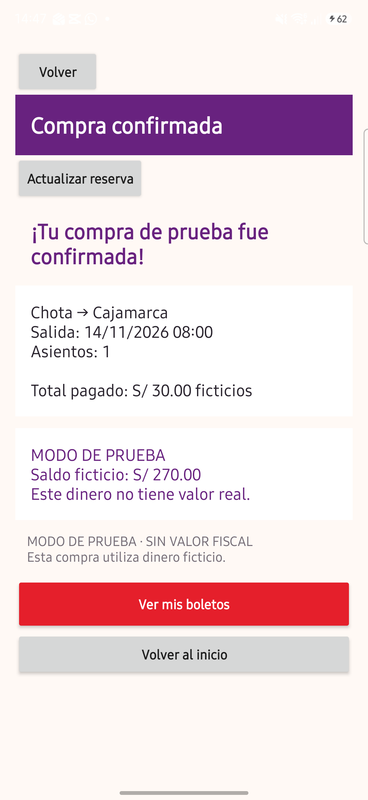

# Sprint 4: confirmacion y boletos de una compra en Android

## Resultado

Android muestra Compra confirmada cuando el servidor informa CONFIRMADA. Desde ahi permite consultar los boletos emitidos de esa compra mediante Ver mis boletos. Las interfaces usan XML y Kotlin y conservan la identidad visual morada, roja y crema.

Este incremento conecta la confirmacion con los boletos de la reserva seleccionada. El acceso general Mis boletos desde Inicio, la lista de todas las compras, el QR y el historial corresponden a los siguientes incrementos. No se reutiliza el boleto estatico del boceto como si fuese un boleto comprado.

## Paso a paso para comprobarlo

1. Iniciar sesion y buscar una salida de prueba.
2. Seleccionar asientos y guardar los datos de los pasajeros.
3. Revisar el resumen y pagar con saldo ficticio.
4. Ver Compra confirmada con ruta, fecha de salida, asientos, total pagado y saldo restante. Se ocultan formulario, boton de pago y edicion de pasajeros.
5. Pulsar Ver mis boletos. Se consulta GET /api/v1/reservas/:id/boletos con el token Firebase vigente.
6. Revisar una tarjeta por pasajero: codigo CBP-, asiento, nombre, DNI, salida/llegada, terminales, precio unitario, estado y fecha de emision. Se presenta MODO DE PRUEBA y SIN VALOR FISCAL.
7. Volver regresa a la confirmacion; Volver al inicio limpia el recorrido de compra. No se permite volver a editar o cancelar la compra confirmada mediante controles de la reserva temporal.

Para una prueba manual completa se descuenta saldo ficticio al pagar una compra nueva. Consultar o actualizar los boletos no cobra nada. Si la conexion falla, Actualizar boletos repite solo la consulta. Una lista vacia explica que no hay boletos emitidos y que no hace falta volver a pagar. Una sesion invalida muestra la opcion de iniciar sesion.

Si se pierde la respuesta del pago, el flujo existente consulta el resumen: si el servidor ya confirmo, se presenta la confirmacion y no se ofrece un segundo pago. Al recargar una reserva confirmada tambien se reconstruye esta pantalla. Si los datos del boleto proceden de una compra anterior a la migracion 009, la tarjeta informa que se recuperaron al incorporar la emision electronica.

## Archivos para explicar en la exposicion

| Archivo | Responsabilidad |
| --- | --- |
| data/model/BoletoPrueba.kt | Modelo de la copia del boleto emitido en SQL |
| data/remote/ReservasApi.kt | Ruta protegida de boletos de una reserva |
| data/repository/ReservasRepository.kt | Contrato para consultar boletos |
| data/repository/RetrofitReservasRepository.kt | Token por peticion, validacion de datos y errores de conexion |
| ui/compra/PasajerosFragment.kt | Cambia de resumen a confirmacion y abre los boletos |
| res/layout/confirmacion_compra.xml | Contenido visual de la compra confirmada |
| ui/compra/BoletosCompraViewModel.kt | Estados de carga, lista, errores y sesion |
| ui/compra/BoletosCompraFragment.kt | Presenta las tarjetas y controla la navegacion |
| res/layout/boletos_compra.xml | Contenedor de la consulta y botones de reintento |
| res/layout/item_boleto_compra.xml | Tarjeta de cada pasajero y su viaje |

Las rutas anteriores parten de app/src/main/java/com/app/transporte_chota_bus para Kotlin y app/src/main para los recursos. Los comentarios son generales por bloque, para explicar su funcion sin repetir cada linea.

## Validacion y privacidad

El repositorio exige PRUEBA, PEN y EMITIDO, valida UUID, codigo, importe decimal positivo, DNI y fechas. Rechaza listas con boletos de otra reserva, asientos duplicados, codigos duplicados o mas de nueve boletos. Convierte las horas con FechaHoraServidor y las presenta en America/Lima, incluyendo las fechas PostgreSQL con offset y microsegundos.

El UID sigue procediendo de Firebase y se comprueba antes y despues de cada solicitud; el servidor tambien filtra por propietario. El ViewModel descarta los boletos si cambia la cuenta. Los argumentos de navegacion llevan solamente el identificador de reserva: no transportan DNI, nombres, tokens ni el saldo. Los boletos se conservan en memoria del ViewModel durante la recreacion de actividad, sin agregarlos a DataStore ni al estado guardado.

No se agregaron dependencias ni migraciones SQL en este incremento. No se modificaron los documentos maestros ni se genero un commit automaticamente.

## Verificacion realizada — 2026-11-13

- 153 pruebas unitarias Android aprobadas, cero fallos.
- Compilacion assembleDebug y assembleDebugAndroidTest aprobada.
- lintDebug completado sin errores. Se mantiene la advertencia previa de AGP con compileSdk 37.1.
- Prueba optativa directa en el Samsung: OK (1 test). Utiliza una compra propia que ya estaba confirmada; no crea ni paga otra reserva. Comprueba confirmacion, boton, codigos y datos contra el servidor, recreacion de actividad, regreso a confirmacion y vuelta al inicio.
- Se verifico que la consulta no modifico saldo ni identificadores de boletos.
- La app quedo actualizada conservando los datos locales. Se uso adb install -r y am instrument, evitando la desinstalacion que puede provocar connectedDebugAndroidTest en el telefono personal.

Repetir la validacion local desde Git Bash en la raiz Android:

```bash
./gradlew :app:testDebugUnitTest :app:assembleDebug :app:assembleDebugAndroidTest :app:lintDebug
```

La prueba BoletosCompraInstrumentedTest se activa expresamente con boletosServidor=true y reservaConfirmadaId de una compra perteneciente a la sesion ya iniciada. El telefono debe estar desbloqueado y el servidor disponible por adb reverse. No publica capturas de los boletos con datos personales: la evidencia guardada solo muestra la confirmacion, ruta e importes.



## Siguiente paso

Implementar la consulta general de Mis boletos desde Inicio para acceder tambien a compras anteriores, seguida del detalle con QR. El historial sera una consulta separada de compras y estados, sin confundir reservas temporales con compras pagadas.

Actualizacion: ya se implementaron [Mis boletos desde Inicio y el detalle con QR](mis-boletos-detalle-qr.md). El historial es el siguiente incremento.
