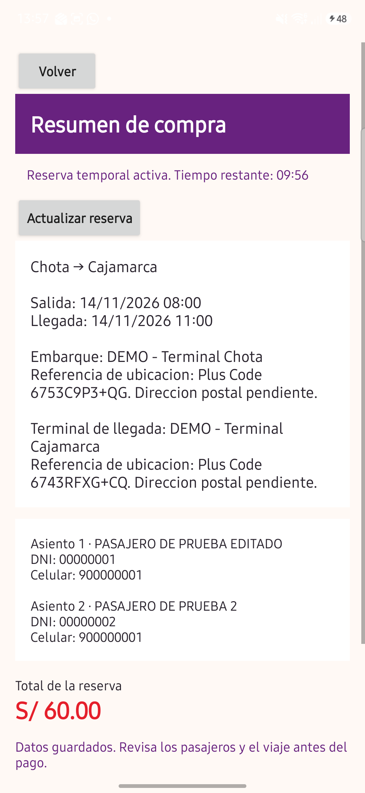

# Sprint 4 — pasajeros y resumen de compra

## Resultado de este incremento

La reserva temporal permite registrar un pasajero por asiento, guardar el formulario completo en PostgreSQL y consultar un resumen privado con viaje, terminales, horarios, pasajeros, asientos y total. Las pantallas son XML y los bloques principales de Kotlin, JavaScript y SQL contienen comentarios generales para la exposicion.

Flujo: Buscar viajes -> Seleccionar salida -> Reservar asientos -> Datos de pasajeros y resumen -> Guardar y ver resumen. Editar pasajeros permite corregirlos mientras la reserva sigue vigente. El pago y la emision del boleto siguen pendientes; guardar el formulario no confirma un pago ni renueva el plazo de reserva.

## Paso 1: modelo SQL

007_pasajeros_reserva.sql crea pasajeros_reserva y guardar_pasajeros_reserva. La migracion ya esta aplicada en chota_bus; no repetirla sobre la base actual. La clave primaria une reserva y numero de asiento, y la clave foranea exige que ese asiento pertenezca al detalle reservado. Cada DNI debe ser diferente dentro de la misma reserva; el celular de contacto puede repetirse. La reserva, su precio y su vencimiento no se modifican al guardar pasajeros.

La funcion comprueba propietario, bloquea primero la salida y despues la reserva siguiendo el orden de reservar/cancelar, verifica vigencia y valida todos los pasajeros antes de reemplazar el formulario anterior. El guardado es atomico: un error no borra los datos ya guardados. Los intentos repetidos con el mismo formulario no duplican pasajeros. Una reserva vencida, cancelada o confirmada no admite modificaciones.

## Paso 2: API autenticada

PUT /api/v1/reservas/:id/pasajeros recibe un objeto con pasajeros. GET /api/v1/reservas/:id/resumen permite recuperar el resumen. Ambos requieren Authorization con un ID token Firebase y usan su UID; una reserva ajena responde 404. Las respuestas incluyen no-store y no contienen UID ni datos de otras reservas.

Ejemplo FICTICIO de cuerpo:

```json
{
  "pasajeros": [
    {"asiento": 1, "nombreCompleto": "PASAJERO DE PRUEBA", "dni": "00000001", "celular": "900000001"}
  ]
}
```

Debe enviarse exactamente un pasajero por asiento reservado. No se aceptan UID, precio, total o campos extra. El nombre admite de 1 a 200 caracteres; DNI es una cadena de 8 digitos y celular una cadena de 9. Son validaciones de formato: no se consulta una fuente oficial para comprobar identidad o titularidad del telefono.

La respuesta contiene datos.reserva (mismo contrato de reservas), datos.viaje (fechas y terminales de embarque/llegada), datos.pasajeros, datos.datos_completos y datos.puede_continuar. El total corresponde al precio que PostgreSQL fijo al reservar, no a un calculo enviado por el formulario. puede_continuar requiere reserva pendiente y vigente, viaje habilitado, inventario retenido y pasajeros completos. Esa lectura es una fotografia: el futuro pago tendra que volver a validar el estado bajo bloqueo.

## Paso 3: Android

- ResumenCompra y PasajeroReserva representan el contrato del servidor. RetrofitReservasRepository valida asientos, DNI diferentes, integridad del total y datos completos; mantiene el ID token en memoria y reutiliza la renovacion de sesion existente.
- ValidadorPasajeros reutiliza ValidadorPerfil para nombre, DNI y celular. Ademas comprueba que la lista coincida con los asientos de la reserva y no se repita el DNI.
- PasajerosViewModel conserva los borradores en memoria durante cambios de configuracion. Si se pierde la respuesta del PUT, conserva lo escrito y permite reintentar el formulario completo. Una recarga no reemplaza borradores modificados. Al cambiar de cuenta elimina la informacion de la vista.
- PasajerosFragment utiliza item_pasajero.xml por cada asiento. Los campos tienen identificadores propios y etiquetas accesibles. saveEnabled=false evita guardar sus textos automaticamente en el estado de Android; tampoco se guardan DNI o celular en DataStore, preferencias, argumentos o registros. Tras recrear el proceso se recuperan solo los datos que ya se guardaron en SQL mediante el id de reserva.
- datos_pasajeros.xml incluye resumen_compra.xml. Se alterna formulario/resumen con el mismo ViewModel. Los datos ingresados no se trasladan entre pantallas mediante Bundles. Volver con cambios sin guardar solicita descartarlos. Volver a asientos permite cancelar la reserva desde la pantalla existente.

El contador toma hora_servidor y el plazo original de la reserva mediante un reloj monotono. Al vencer, el formulario se bloquea y el resumen deja de permitir continuar. No se crea un nuevo plazo por editar, actualizar o guardar.

FechaHoraServidor convierte fechas ISO con Z o desplazamiento horario mediante OffsetDateTime. Esta conversion es necesaria para las fechas PostgreSQL con -05:00 y microsegundos en las versiones Android/desugaring soportadas. Horarios de salida y llegada se presentan en America/Lima.

## Paso 4: prueba manual

1. Mantener PostgreSQL y npm start activos. En esta entrega el usuario ya reinicio el servidor con los nuevos endpoints.
2. Conectar el telefono y configurar adb reverse tcp:3000 tcp:3000, como en el incremento anterior. La app actualizada ya fue instalada conservando los datos.
3. Iniciar sesion y buscar una salida DEMO con 2 pasajeros. Si no hay salidas para la fecha, cargar las de prueba mediante 002 y su inventario mediante 006; no repetir 005 o 007.
4. Reservar 2 asientos y pulsar Datos de pasajeros y resumen.
5. Completar nombre, DNI y celular de cada pasajero. Probar primero campos vacios o DNI repetido: deben marcarse y no guardarse.
6. Pulsar Guardar y ver resumen. Comprobar asientos, ruta, fechas, terminales, personas y total. Editar pasajeros permite corregir sin cambiar el vencimiento.
7. Girar durante una edicion y comprobar que conserva el borrador. Cancelar la reserva desde Asientos y verificar que ya no admite cambios.

Para la exposicion y las capturas utilizar personas ficticias. Los datos de pasajeros guardados permanecen en PostgreSQL asociados al historial, incluso si luego se cancela la reserva; cancelar libera el asiento y no elimina ese registro. No se guardan documentos reales durante las pruebas automatizadas de este incremento.

## Verificacion realizada — 2026-11-13

- 62 pruebas HTTP/unitarias del servidor aprobadas.
- 30 pruebas de integracion PostgreSQL/HTTP aprobadas en un esquema aislado que se elimina al terminar. Incluyen propietario, lista exacta de asientos, DNI repetido, conservacion ante error, cancelacion concurrente y vencimiento.
- 134 pruebas unitarias Android aprobadas, incluyendo formulario, borradores, sesion, Retrofit y conversion de fechas.
- assembleDebug, assembleDebugAndroidTest y lintDebug completados sin errores. El proyecto conserva advertencias de estilo/compatibilidad ya conocidas.
- Dos pruebas directas en el Samsung conectado: conversion de zona horaria y recorrido completo con sesion real, dos pasajeros ficticios, edicion tras recrear la actividad, guardado y resumen de SQL. Resultado OK (2 tests). La reserva de esa prueba se cancelo en finally.

La prueba optativa PasajerosServidorInstrumentedTest requiere pasajerosServidor=true, fechaDemo y salidaDemoId que correspondan a Chota/Cajamarca DEMO. Se ejecuta con instalacion adb -r y am instrument, no con connectedDebugAndroidTest en el telefono personal, para conservar la instalacion y el estado local. No imprime tokens. Los registros de personas ficticias quedan asociados a una reserva CANCELADA de la cuenta de prueba.



## Siguiente incremento

Integrar un pago de prueba con verificacion en el servidor. Aun no existe endpoint de pago ni boton que simule una compra cobrada. Al incorporar el pago se revalidara vigencia, pasajeros e importe y se definira la confirmacion transaccional antes de emitir boletos.

Referencias: https://www.postgresql.org/docs/current/explicit-locking.html ; https://developer.android.com/guide/fragments/communicate

Actualizacion: el siguiente incremento se implemento como [saldo ficticio propio](sprint-4-saldo-pruebas.md), en lugar de una pasarela externa, por decision del usuario.
