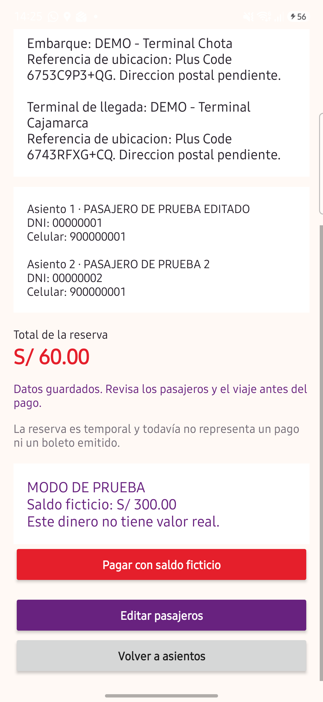

# Sprint 4: compra con saldo ficticio

Se sustituye la pasarela sandbox prevista por un simulador propio, por decision del usuario. Cada cuenta Firebase dispone de S/ 300 ficticios, asignados una sola vez al consultar el saldo o al efectuar su primera compra. Son S/ 300 por cuenta, no por pasajero ni por compra. El saldo no vence ni se repone al iniciar sesion, reinstalar o repetir solicitudes. Esta version no ofrece recargas.

## Flujo para presentar

1. Iniciar sesion, buscar una salida, reservar asientos y completar los pasajeros.
2. Guardar y ver resumen. Se muestra MODO DE PRUEBA y el saldo ficticio disponible.
3. Pulsar Pagar con saldo ficticio y confirmar el importe del resumen.
4. El servidor valida propietario, plazo original, pasajeros, salida y asientos; obtiene el importe de SQL.
5. En una transaccion descuenta el saldo, registra el pago y cambia la reserva a CONFIRMADA. Un cargo de S/ 60 deja S/ 240 sobre el saldo inicial de S/ 300.
6. La pantalla muestra la confirmacion y el saldo restante. Si se pierde la respuesta, se consulta el estado; repetir el mismo pago no duplica el cargo.

El boleto electronico y su consulta en Mis boletos/Historial son el siguiente incremento. La confirmacion actual no representa un comprobante fiscal ni un cobro de dinero real. Las compras de prueba confirmadas no admiten cancelacion/reembolso desde el endpoint de reservas temporales.

## Archivos y responsabilidad

- backend/sql/008_saldo_pruebas.sql: tablas saldos_prueba y pagos_prueba, funcion pagar_reserva_prueba. Cuenta persistente por UID y pago unico por reserva.
- backend/src/pagos-prueba.js: rutas protegidas GET /api/v1/saldo-prueba y POST /api/v1/reservas/:id/pago-prueba. El POST no acepta importe, saldo ni UID. Cache-Control: no-store.
- Android: ReservasApi y RetrofitReservasRepository transportan y validan respuestas; PasajerosViewModel coordina el pago y su recuperacion; PasajerosFragment y resumen_compra.xml muestran el saldo y piden confirmacion.
- Hay comentarios generales en los bloques principales para explicar su funcion durante la exposicion.

Los importes usan NUMERIC en SQL y texto decimal en la API. Los bloqueos siguen salida, reserva y saldo: dos compras de la misma cuenta se serializan, y no pueden dejar saldo negativo. Un pago repetido devuelve el registro existente. Si no alcanza el saldo se devuelve 422 y toda la operacion se revierte. Una reserva vencida, cancelada, ajena o incompleta no admite pago.

## Configuracion local

La migracion 008 se aplica una sola vez despues de 007. No volver a ejecutar las migraciones de creacion en la base existente. En esta implementacion ya se aplico 008 en la base local y se habilito PAGOS_PRUEBA_HABILITADOS=true en backend/.env (ignorado por Git). Reiniciar el servidor para cargar rutas y bandera nuevas.

En Git Bash, dentro de backend:

```bash
# Detener el proceso anterior con Ctrl+C y luego:
npm start
```

Si se usa el telefono por USB:

```bash
adb reverse tcp:3000 tcp:3000
```

## Despliegue

El ejemplo .env.example conserva PAGOS_PRUEBA_HABILITADOS=false. NODE_ENV=production bloquea el simulador incluso si la bandera queda activada. Desplegar no activa automaticamente una pasarela real: se necesitara otra integracion, credenciales del comercio, validacion del pago en servidor y pruebas independientes. Los saldos y pagos de prueba no se convierten en fondos o compras reales; se conservaran identificados y separados de los registros productivos.

## Validacion reproducible

```bash
cd backend
npm test
npm run test:db
```

Las pruebas PostgreSQL crean y eliminan solo su esquema temporal. Cubren saldo inicial, persistencia, propietario, importe manipulado, pago repetido simultaneo, saldo insuficiente, compras simultaneas del mismo cliente, vencimiento, pasajeros incompletos y cancelacion concurrente. No descuentan el saldo de cuentas de la app.

```bash
./gradlew :app:testDebugUnitTest :app:assembleDebug :app:assembleDebugAndroidTest :app:lintDebug
```

En el telefono personal instalar con adb install -r para conservar la sesion. No ejecutar connectedDebugAndroidTest: la limpieza de ese comando puede desinstalar la app. No se realizan compras automaticas sobre la cuenta personal; la verificacion del pago completo se hace con cuentas sinteticas dentro del esquema SQL aislado.

## Resultados de esta entrega

- 68 pruebas HTTP/unitarias de servidor aprobadas.
- 36 pruebas PostgreSQL/HTTP aprobadas en un esquema temporal, incluyendo el descuento y la confirmacion completos.
- 140 pruebas unitarias Android aprobadas.
- Compilacion de app, APK de pruebas y lintDebug completados sin errores; se conserva la advertencia conocida de AGP/compileSdk.
- Migracion 008 aplicada en PostgreSQL local, servidor reiniciado por el usuario y ruta de saldo comprobada: devuelve 401 sin sesion.
- App actualizada en el telefono conservando sus datos. Tras desbloquearlo, la prueba directa finalizo con OK (2 tests): fechas y recorrido de pasajeros/resumen con saldo ficticio y boton de pago habilitado. Se comprobo que el saldo permanece en S/ 300.00; no se realizaron cargos y se cancelo la reserva temporal creada por la prueba.



Actualizacion: la [emision atomica de boletos en el servidor](sprint-4-emision-boletos.md) ya esta implementada. La visualizacion en Android es el siguiente paso.
